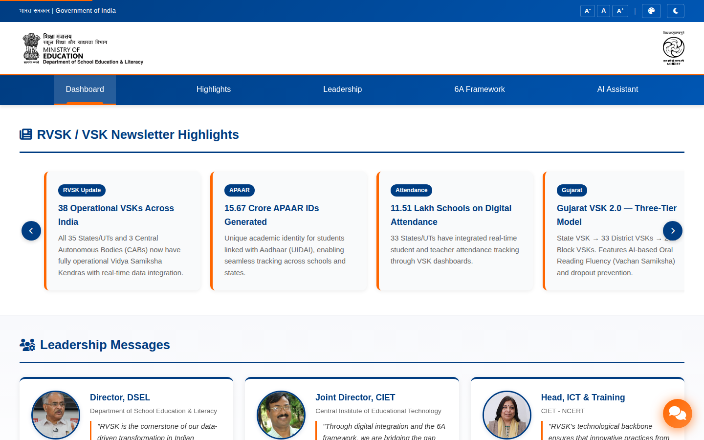
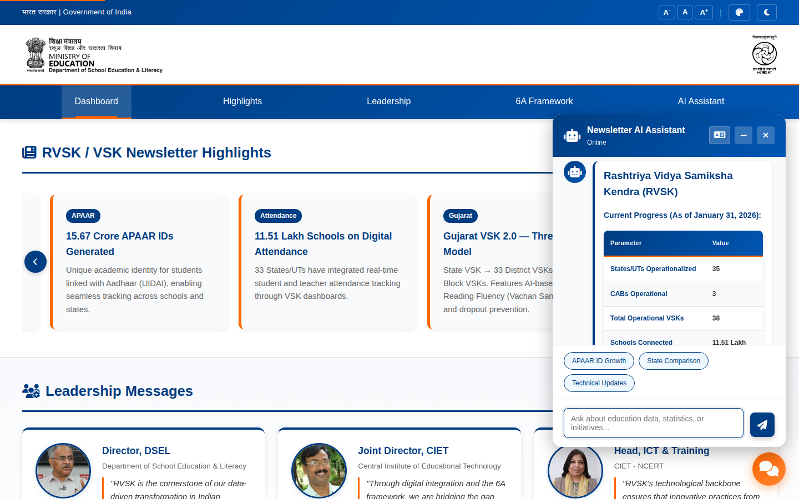
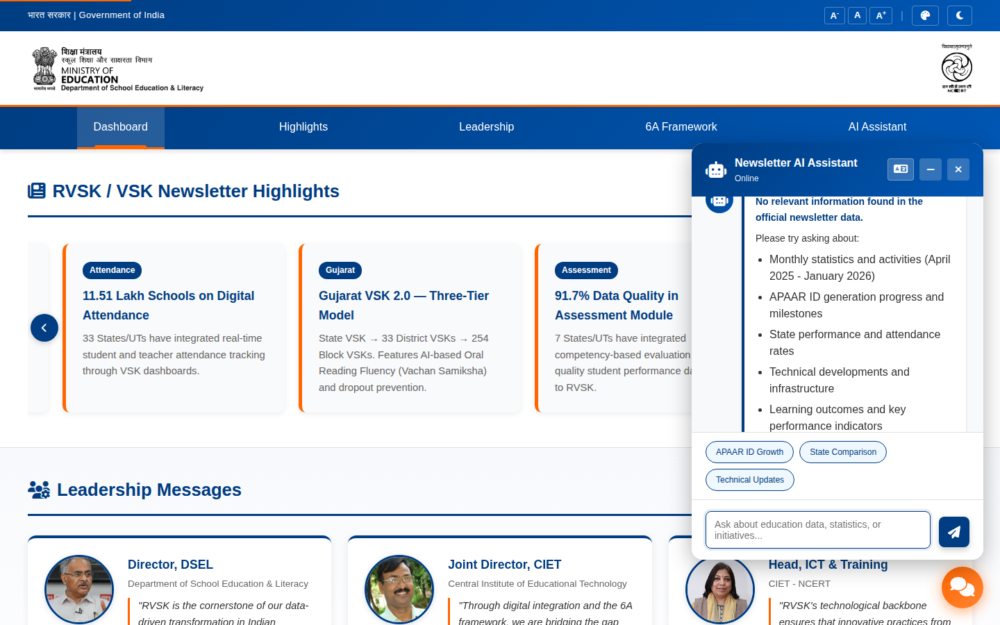
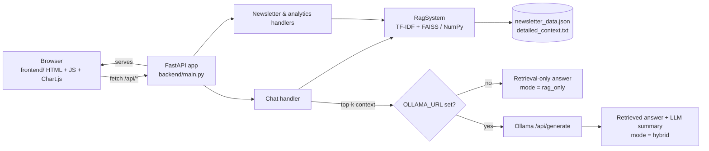

# MoE Newsletter Dashboard with a Retrieval-First Chatbot

> A FastAPI + vanilla-JS dashboard for Ministry of Education (RVSK / VSK) newsletters whose chatbot answers **only from retrieved newsletter content**, works fully without an LLM, and can optionally add Ollama-generated summaries on top.

[](https://github.com/Akshatb848/LLM-dashboard/actions/workflows/ci.yml)
[](LICENSE)
[](https://www.python.org/)
[](https://fastapi.tiangolo.com/)



<table>
<tr>
<td width="50%"></td>
<td width="50%"></td>
</tr>
<tr>
<td><sub><b>In scope</b> — “How many operational VSKs are there?” is answered from the bundled newsletter data.</sub></td>
<td><sub><b>Out of scope</b> — “What is the capital of France?” is refused instead of guessed.</sub></td>
</tr>
</table>

<sub>Screenshots were captured headlessly with Playwright against a local run in <b>retrieval-only mode</b> (no LLM configured), using only the data committed in <code>backend/data/</code>.</sub>

---

## Key features

- **Retrieval-first chatbot** – every answer is assembled from chunks retrieved out of the newsletter dataset (TF-IDF vectors, searched with FAISS when installed, otherwise NumPy cosine similarity).
- **No-hallucination fallback** – if retrieval finds nothing relevant, the API returns a fixed “No relevant information found in the official newsletter data” message rather than generating text.
- **Optional LLM layer** – set `OLLAMA_URL` and the retrieved context is summarised by an Ollama model (`/api/generate`, temperature 0.3). If Ollama is unset or fails, the app silently stays in retrieval-only mode; the response `mode` field reports `rag_only` or `hybrid`.
- **Structured answers** – month, KPI, state-performance and leadership queries are rendered as formatted HTML tables from the structured JSON, not free text.
- **Bilingual (English / Hindi)** – Hindi queries are detected and answered with Hindi labels.
- **Dashboard UI** – newsletter highlights carousel, leadership messages, 6A framework view, accessibility controls (font size, contrast, dark mode) and a floating chat widget.
- **REST API** – monthly newsletters, analytics overview, full dataset, health and LLM-status endpoints.

## Architecture



Request flow for `POST /api/chat`:

1. Empty query → “no relevant information” response.
2. `RagSystem.search()` ranks chunks; if the best score is `0`, return the refusal message.
3. Try a structured formatter (month / KPI / state / leadership) over the retrieved data; otherwise list the top retrieved passages.
4. If an LLM is configured, append its summary of the top-3 chunks; any LLM error is swallowed and the retrieval answer is returned unchanged.

## Tech stack

| Layer | Tools |
|---|---|
| Backend | Python 3.11+, FastAPI, Uvicorn, Pydantic |
| Retrieval | scikit-learn `TfidfVectorizer`, NumPy, optional `faiss-cpu` |
| LLM (optional) | Ollama HTTP API (default model `llama3.1`, custom `Modelfile` included) |
| Frontend | HTML, CSS, vanilla JavaScript, Chart.js, marked |
| Ops | Docker, Docker Compose, Render (`render.yaml`), GitHub Actions |

## Quick start

### Local

```bash
git clone https://github.com/Akshatb848/LLM-dashboard.git
cd LLM-dashboard
python -m venv .venv && source .venv/bin/activate
pip install -r requirements-dev.txt          # runtime: backend/requirements.txt
cp .env.example .env                         # optional; all variables are optional
uvicorn backend.main:app --reload --port 8000
```

Open <http://localhost:8000> – the FastAPI app serves the frontend as well as the API (interactive docs at `/docs`).

### Docker

```bash
docker compose up --build
# → http://localhost:8000
```

To enable the LLM layer with an Ollama server running on the host:

```bash
OLLAMA_URL=http://host.docker.internal:11434 docker compose up --build
```

## Environment variables

See [`.env.example`](.env.example).

| Variable | Default | Purpose |
|---|---|---|
| `OLLAMA_URL` | *(empty)* | Ollama base URL. Empty → retrieval-only mode. |
| `OLLAMA_MODEL` | `llama3.1` | Model used when `OLLAMA_URL` is set. |
| `SERVICE_URL` | deployed URL | Only for `keep_alive.py` / `keep_alive_cron.py`. |

## API

| Method | Path | Description |
|---|---|---|
| GET | `/api/health` | Status, chunk count, `rag_only` / `hybrid` mode |
| GET | `/api/llm/status` | Whether an LLM is configured |
| POST | `/api/chat` | `{"query": "...", "language": "en" \| "hi"}` → `{answer, mode, sources}` |
| GET | `/api/newsletter/months` | Months available in the dataset |
| GET | `/api/newsletter/{month}` | Data for one month, e.g. `April 2025` |
| GET | `/api/analytics/overview` | Attendance and APAAR trends |
| GET | `/api/analytics/full-data` | Full newsletter dataset |
| GET | `/api/admin/stats` | Documents / chunks indexed, FAISS on/off |

```bash
curl -s localhost:8000/api/chat -H 'content-type: application/json' \
  -d '{"query": "How many operational VSKs are there?"}'
```

## Testing

```bash
pytest -q        # API, retrieval and LLM-handler tests (LLM calls are mocked)
ruff check .     # lint
```

CI (GitHub Actions) runs ruff and pytest on Python 3.11 and 3.12, then builds the Docker image and checks `/api/health` inside the container.

## Project structure

```
backend/
  main.py               FastAPI app, static file serving, health endpoints
  api/                  chat, newsletter, analytics, admin routers
  rag/rag_system.py     chunking, TF-IDF index, FAISS/NumPy search
  llm/                  Ollama client, prompts, response formatting/cleanup
  data/                 newsletter_data.json, detailed_context.txt
frontend/               index.html, css/, js/ (dashboard + chat widget), assets/
tests/                  pytest suite
attached_assets/        reference newsletters and design notes used during development
Modelfile               Ollama model definition for the newsletter assistant
Dockerfile.backend      container image (API + frontend)
render.yaml             Render deployment blueprint
```

Further notes: [OLLAMA_DEPLOYMENT.md](OLLAMA_DEPLOYMENT.md), [RELIABILITY.md](RELIABILITY.md), [PROMPT_ENGINEERING_IMPLEMENTATION.md](PROMPT_ENGINEERING_IMPLEMENTATION.md), [NEWSLETTER_FEATURES.md](NEWSLETTER_FEATURES.md).

## Limitations

- Retrieval is **lexical** (TF-IDF). The refusal path triggers only when a query shares no terms with the corpus; loosely related queries may still return the closest (possibly off-topic) passages.
- The knowledge base is the static JSON/text bundled in `backend/data/`; there is no ingestion pipeline for new newsletter PDFs.
- LLM summaries depend on the Ollama model; grounding is enforced by prompting and post-processing, not by verification of every generated sentence.
- No authentication; all endpoints (including `/api/admin/stats`) are public and CORS is open (`*`).
- The UI loads Chart.js, marked, Font Awesome and Google Fonts from public CDNs.

## License

[MIT](LICENSE) © 2026 Akshat Banga. Government of India / Ministry of Education / NCERT names, emblems and logos in `frontend/assets/` belong to their respective owners and are not covered by this license.

## Author

**Akshat Banga** — AI Generalist · [github.com/Akshatb848](https://github.com/Akshatb848)
